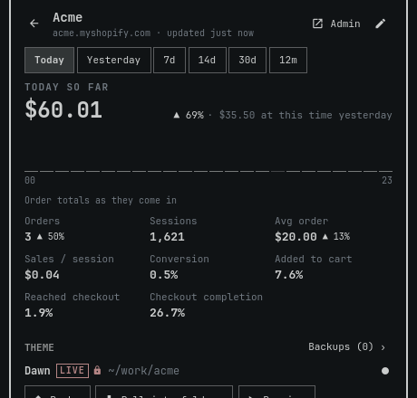

# Shop for Omarchy

An [Omarchy](https://omarchy.org) (Quickshell) plugin that shows today's
Shopify sales for each of your stores in the bar, and pushes, pulls or
previews themes from a keyboard-driven panel. All Shopify access goes through
the Shopify CLI and your own CLI session. Shop stores no tokens or passwords.



## What it does

- **Sales in the bar.** Each store you choose shows today's sales and a ▲/▼
  trend against the same time yesterday. With four or five stores the pills
  shorten to initials; with more, the bar shows one total. It can also show
  only a total, or only an icon.
- **Home.** Every store at a glance for Today, the last 7 or the last 30
  complete days, with the trend and a sparkline per store.
- **Store dashboard.** Pick Today, Yesterday, 7d, 14d, 30d or 12m to see
  sales with a trend and its baseline, a sparkline of the period, and eight
  tiles: orders, sessions, average order, sales per session, conversion,
  added to cart, reached checkout and checkout completion. 12m adds lifetime
  sales.
- **New-order alerts.** A desktop notification, plus an optional sound, when
  a store gets a new order.
- **Themes.** Push a local folder to a theme, pull a theme into a folder,
  and preview your folder on the store's development theme. Every push and
  restore backs up the target theme first, and every pull into a non-empty
  folder copies the folder first.
- **Find my stores.** Shop lists the stores on your Shopify account,
  including accounts with several organizations, and adds the ones you pick.

### About the figures

Shop shows two definitions of sales, and the store view says under the
chart which one it shows.

- **Today** counts every order's total as it comes in (the orders API, in
  real time, test orders left out), and so do its hourly chart, its "at
  this time yesterday" comparison and new-order alerts. On a very busy day
  Today may sum only part of the day's orders; the store view then says the
  total is partial and shows no sales trend, average order value or sales
  per session, since they would compare a partial sum with a complete one.
- **Yesterday and the completed periods** (7d, 14d, 30d, 12m, lifetime) use
  Shopify Analytics total sales, the admin's "Total sales": net of returns
  (booked on the day of the return), without test orders. On Yesterday the
  figure, its hourly chart and "the day before" all use it, so a day with
  only a return shows a negative figure, and Today's figure and tomorrow's
  "yesterday" for the same day can differ.

## Requirements

**No manual setup.** Everything Shop needs is either in Omarchy's base
install or installed by Shop itself, with Omarchy's own tools, after one
confirmation in the panel. Nothing has to be typed in a terminal.

- **Already on Omarchy:** `ruby`, `mise` and `wl-clipboard` are Omarchy base
  packages, and `setpriv` comes with util-linux. Shop's helpers are Ruby
  scripts that run on the system ruby.
- **Installed by Shop:** Node 26.13.0 and Shopify CLI 5.0.1. Omarchy already
  declares Node as one of its default mise tools and installs its own npm
  CLIs through mise's npm backend; Shop uses that same mise, only with
  pinned versions. When they are missing, the panel offers **Install** and,
  after you confirm in a dialog that shows both commands, runs:

  ```sh
  mise install node@26.13.0
  mise exec node@26.13.0 -- mise install npm:@shopify/cli@5.0.1
  ```

  - You can also run these two commands yourself; Shop finds the result
    either way.
  - They install into `~/.local/share/mise/installs` (or
    `$MISE_DATA_DIR/installs`) and **don't change your mise config**:
    `mise install` never adds a tool to `config.toml`, and nothing is put
    on your PATH.
  - npm package install scripts run during the install, as with any npm
    package.
- Shop uses **only this pinned CLI**, run directly with the pinned Node. It
  never uses a `shopify` on your PATH, or one from Homebrew or the AUR.

**Optional (Shop works without them and says so in Settings):**
`notify-send` (libnotify) for new-order notifications, and `pw-play`
(PipeWire) or `paplay` for the order sound.

## Install

```sh
omarchy plugin add https://github.com/ronald2wing/Omarchy-Shop --enable
```

## First run

Click the Shop icon in the bar. With no stores yet, the panel shows a
checklist:

1. **Shopify CLI 5.0.1 installed.** Done already if you ran the two
   commands above; otherwise press **Install** and confirm.
2. **Sign in to Shopify.** Press **Sign in**: the CLI opens your browser.
3. **Add a store.** Press **Find my stores** to pick from the stores on your
   account, or **Enter a domain** and type `your-store.myshopify.com`.
4. **Grant sales access for each store.** Adding a store never opens a
   browser on its own. Open the store and press **Grant access…**. This runs
   `shopify store auth` with the read-only scopes `read_reports,read_orders`
   and opens your browser once; you can cancel it. Until then the store
   shows "Sales access needed" instead of figures.

Optional: in the store's Edit view, link a theme folder and choose a target
theme. Push, pull and preview stay off until a folder is linked.

## Keyboard

Press `?` in the panel for every key in the current view. The common ones:

| Key | Action |
| --- | --- |
| `↑`/`↓` or `j`/`k` | Move |
| `Enter` | Open, add or confirm |
| `Esc` / `Backspace` | Back (`Esc` on Home closes the panel) |
| `Tab` / `Shift+Tab` | Switch to the neighbouring bar panel; in Edit, move between fields |
| `r` | Refresh |
| `h`/`l` | Previous / next period (Home: Today, 7d, 30d; store view: all six, also `1`–`6`) |
| `a` / `s` | Add a store / Settings (Home); grant sales access (store view) |
| `Ctrl+j` / `Ctrl+k` | Reorder stores (Home) |
| `e` / `o` | Edit / open Shopify admin (the selected store on Home, or the store view); open the folder copy (Backups) |
| `p` / `u` | Push… / Pull… (store view; both ask first) |
| `d` / `v` | Start or stop preview / open preview in the browser |
| `c` | Cancel the running theme job |
| `b` | Backups |
| `t` | Show or hide the theme result's details |
| `x` / `Delete` | Remove a store (Home, asks first); dismiss the theme result (store view) |
| `/` / `m` | Filter stores / add a store by its domain (Add a store) |
| `i` / `Shift+i` | The banner's first / second action (Install…, Sign in, Open file, Reset config…) |

Left-click a store's pill to open it, right-click to refresh it.

## Theme safety

- **Live theme changes are opt-in.** Pushing or restoring to the live
  theme needs **Live theme changes** turned on for that store (off by
  default; it turns off again when you change the folder or the target),
  and then a confirmation every time. The first live push or restore
  offers to turn it on ("Allow changes to the live theme?") and then asks
  again for the push or restore itself. Keybindings and scripts can't push:
  they can only open the confirmation dialog.
- **Nothing is deleted on Shopify.** Push, pull and restore always pass
  `--nodelete`, so files missing from one side are kept on the other.
- **Preview uses only the development theme.** It runs `shopify theme dev`
  on the store's development theme only (never the live or any other
  theme), bound to `127.0.0.1`, with `--nodelete`. It uploads your folder
  there and holds the store's lock, so push, pull and restore wait until
  you stop it.
- **Some folders are refused.** Shop won't use a folder that:
  - has a `shopify.theme.toml` in it or in any folder above it (any letter
    case), because the CLI searches upward for that file and would read
    extra flags from it, such as `--publish`. The same check runs on the
    folders above Shop's state folder before every theme command.
  - contains any symlink among the files the CLI pushes and pulls (the theme
    directories and a top-level `AGENTS.md` or `DESIGN.md`), even one that
    stays inside the folder: a pull writes through links and a push follows
    them
  - contains a hard-linked file among those files
  - contains a special file (a pipe, socket or device) among those files,
    or a part Shop can't read
  - has more than 20,000 entries
  - is `/`, your home folder, `~/.config`, Shop's state folder or the plugin
    folder (or inside them), isn't yours, or is group- or world-writable
    (the same rule as for the folders above it)
  - sits under a folder that another user owns or that is group- or
    world-writable, such as `/tmp`: anyone who can write there could add a
    `shopify.theme.toml` above the theme or swap the folder for a link
    after Shop checks it

  A running preview re-checks the folder every 15 seconds and stops if it
  stops passing these rules.
- **Backups.** Before every push and every restore, Shop downloads the
  target theme into
  `~/.local/state/shop/backups/<domain>/<epoch>-<themeId>/`. If the backup
  fails, or some of its files could not be downloaded, nothing is pushed
  and the incomplete copy is discarded. If the push fails afterwards, the
  panel says the backup was kept. Shop keeps the 10 newest per store.
  Restore any of them from the store's **Backups** view. A restore uploads
  the backup's files over the theme; files added since the backup stay on
  Shopify.
- **Push uploads `AGENTS.md` and `DESIGN.md` too.** CLI 5.0.1 pushes and
  pulls a top-level `AGENTS.md` and `DESIGN.md` with the theme, so a push
  uploads them to the theme (where anyone with theme access can read them)
  and Preview uploads them to the development theme. The push dialogs name
  the ones your folder has. Keep private notes out of those two files, or
  out of the theme folder.
- **Folder copies before a pull.** Before pulling into a folder that isn't
  empty, Shop copies the folder's theme directories and its top-level
  `AGENTS.md` and `DESIGN.md` (CLI 5.0.1 pulls those too) to
  `~/.local/state/shop/backups/<domain>/local/<epoch>/` (up to 200 MiB;
  larger folders are refused). Shop keeps the 5 newest. Shop never runs git
  on your folder.

## Troubleshooting

- **A theme action fails and the banner says your session expired:** press
  **Sign in again** in the banner. Shop signs out and signs back in.
- **The banner says you're signed out of Shopify:** finding your stores and
  granting sales access need the account session; press **Sign in**. When
  the account session merely expired (Shopify answered 401), the CLI still
  holds its stored theme tokens, so push, pull, preview and restore keep
  working until Shopify asks again (then the session-expired banner above
  shows). **Sign out**, and **Sign in** (which signs out first), delete
  that session: theme actions then need you to sign in again. Both wait
  for a running push, pull, restore or preview to finish first.
- **The CLI-missing banner:** install the two pinned packages (see
  Requirements), or press **Install…** and confirm.
- **"Couldn't check the Shopify CLI":** the startup check timed out or
  failed, so sales stay paused. Press **Retry** (Shop also retries on its
  own after 30 s to 5 minutes).
- **The config banner (config.json couldn't be read):** fix the JSON, or
  press **Reset config…** in the banner. Reset renames the file to
  `config.json.old` and starts empty. It waits for a running push, pull,
  restore, preview or access grant to finish first.
- **The rate-limit banner:** Shopify is throttling. Shop backs off and
  retries on its own; the pills keep the last figures.
- **Push, pull or restore is greyed out with "Stop the preview before you
  …" or "Wait for the … to finish"** (the button's tooltip, or a toast
  when you press the key; over IPC, or when another Shop process holds the
  store: "Another action is running for this store"): a preview or another
  job holds the store. Stop it, or wait for it to finish.
- **Push, pull or preview is greyed out with "Can't …: fix the folder
  first" or "Can't … an empty folder: pull a theme into it first"**: the
  linked folder is missing, unsafe or not a theme (the line under it says
  which), or still empty. Fix or relink the folder; an empty folder can
  only be pulled into.

## Config reference

`~/.config/shop/config.json` is created the first time you change something
in Shop. You can edit it by hand.

```json
{
  "version": 2,
  "pollSeconds": 60,
  "alerts": { "notify": true, "sound": true },
  "bar": { "display": "stores" },
  "stores": [
    { "domain": "acme.myshopify.com", "label": "Acme Apparel", "showInBar": true,
      "theme": { "folder": "/home/me/themes/acme", "target": "live", "allowLive": false } },
    { "domain": "beta.myshopify.com", "label": "Beta Goods", "showInBar": false, "theme": null }
  ]
}
```

- `version` must be `2`. A file without it, or one that isn't valid JSON, is
  left untouched: Shop shows a banner and refuses changes until you fix it or
  press **Reset config…** in the banner.
- `pollSeconds`: how often today's sales refresh, 30–3600 (default 60).
- `alerts.notify`, `alerts.sound`: new-order notification and sound (default
  `true`). The sound plays only with a notification.
- `bar.display`: `stores` (one pill per store), `total` or `icon`.
- `stores`: in display order, at most 50.
  - `domain`: the store's `*.myshopify.com` domain. Required, unique, and
    fixed once added (remove and re-add the store to change it).
  - `label`: display name, 1–80 characters.
  - `showInBar`: default `true`; a newly added store is hidden when five
    stores are already shown (the bar folds more than five into one total).
  - `theme`: `null`, or `{folder, target, allowLive}`. `target` is `"live"`
    or a theme id.
- An invalid store entry stays in the file and is reported in the panel, but
  is never polled or shown.

## IPC reference

```sh
omarchy-shell shop <method> [args...]
```

Every method prints one line of JSON. `status` is the supported read API for
scripts. Methods that would change a theme, install software or add a store
only **open the confirmation dialog** in the panel on the focused monitor
and return `{"ok":true,"pending":"confirm"}`; nothing happens until you
confirm. The dialog expires after 120 s, and a decline blocks further script
requests for 30 s.

| Method | Arguments | What it does |
| --- | --- | --- |
| `status` | | Version, CLI, account and per-store sales summary as JSON |
| `refresh` | | Re-check the CLI and account, then refresh every store |
| `refreshStore` | `domain` | Refresh one store |
| `requestAddStore` | `domain [label]` | Open the "Add … to Shop?" confirmation (label: 1–80 characters) |
| `grantSalesAccess` / `cancelSalesAccess` | `domain` | Start or cancel granting sales access (opens a browser) |
| `discoverStores` | | Find the stores on your account |
| `signIn` / `cancelSignIn` | | Start or cancel Shopify sign-in |
| `cancelInstall` | | Stop a running CLI install |
| `cancelThemeJob` | `domain` | Stop a running push, pull or restore |
| `startPreview` / `stopPreview` | `domain` | Preview on the development theme |
| `listThemes` / `listBackups` / `inspectFolder` | `domain` | Refresh the theme list, backup list or folder check |
| `dismissThemeResult` | `domain` | Clear the last theme result |
| `requestPush` / `requestPull` | `domain` | Open the push or pull confirmation |
| `requestRestore` | `domain backupId` | Open the restore confirmation for `<epoch>-<themeId>` |
| `requestInstallCli` | | Open the CLI install confirmation |

Pushing, pulling, restoring, installing the CLI, signing out, removing a
store, reordering stores and changing settings or a store's details are not
available over IPC; use the panel.

## Privacy, network and processes

### Data written

- Shop writes only under `~/.config/shop` and `~/.local/state/shop`.
  Directories are created `0700` and files `0600`. Shop refuses to use a
  state directory that is a link or owned by another user.
  - `~/.config/shop/config.json`: your settings and stores
  - `~/.local/state/shop/cache.json`: last-known completed periods, store
    currency and time zone, yesterday's order times and amounts and hourly
    totals (the same-time comparison and the Yesterday chart), and the last
    order seen (for alerts after a restart)
  - `~/.local/state/shop/backups/`: theme backups and folder copies
  - `~/.local/state/shop/locks/`, `run/` and `bin/`: per-store locks, an
    empty working directory for the CLI, and a link to the pinned Node
- No customer data is fetched: no names, emails or addresses. Orders are read
  for their totals, time, number and first line items.
- Shop asks for the scopes `read_reports,read_orders`. Your Shopify session
  and store tokens are kept by the Shopify CLI, not by Shop.
- Theme error details are shown in the panel and never written to disk.
- Where the sales figures come from: What it does › About the figures.

### Network

- The plugin itself opens no network connections. The one exception is
  loopback readiness checks for preview, which connect to `127.0.0.1`.
- All Shopify access goes through the Shopify CLI over TLS.
- The CLI also checks the npm registry for newer versions of itself. Shop
  **blocks the CLI's self-upgrade**: background calls run with `CI=1` and
  `--no-input`, and every call runs with `npm_config_dry_run=true` and a PATH
  without npm.
- The npm registry is contacted on purpose only during the install you
  confirm, forced to `https://registry.npmjs.org/` with strict TLS.

### Processes

- Every helper and every CLI call has a deadline. When it runs out, or you
  cancel, Shop stops the whole process group: TERM, then KILL after a short
  grace. The CLI is also killed if its helper dies. A push, pull or
  restore stopped this way says "nothing changed" only when its helper
  reported that the write had not begun; otherwise (it had begun, or the
  helper was killed before it could say) the store card says files may
  already have changed and points at the backup or folder copy taken
  first, when there is one.
- Child processes get a minimal environment and an empty working directory.
  No shell is ever used to run them.
- The exception is `Qt.openUrlExternally`, used for Admin links, the preview
  URL, folder copies, the config file and the state folder. It hands the URL
  to the desktop's opener (`xdg-open`), which Shop does not supervise. Shop
  opens only the store's admin, the local preview address, its own folder
  copies, its own `config.json` and its own `~/.local/state/shop`.

## Uninstall

```sh
omarchy plugin remove shop
rm -rf ~/.config/shop ~/.local/state/shop
```

The second command also deletes your theme backups and folder copies; copy
out anything you want to keep first.

Optionally remove the pinned CLI and Node, only if nothing else on your
machine uses Node 26.13.0:

```sh
mise uninstall npm:@shopify/cli@5.0.1 node@26.13.0
```

## Development

```sh
tests/run                               # every check
tests/run tests/ruby/test_validate.rb   # or just the tests you name
```

[CONTRIBUTING.md](CONTRIBUTING.md) describes the layout, the helper
contract, the UI conventions and what the checks cover.

## License

MIT; see [LICENSE](LICENSE).
